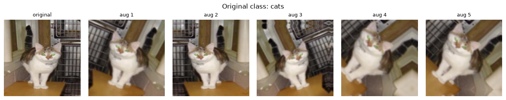
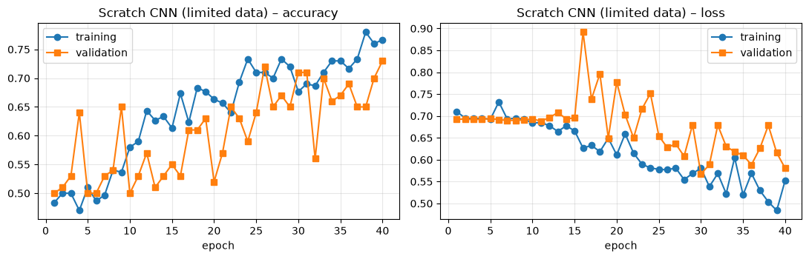
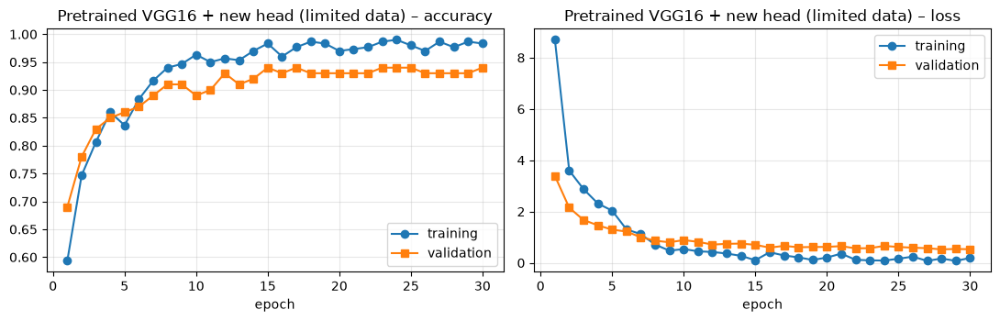
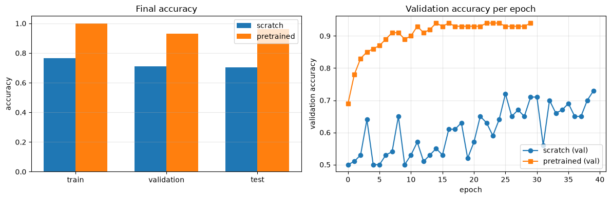
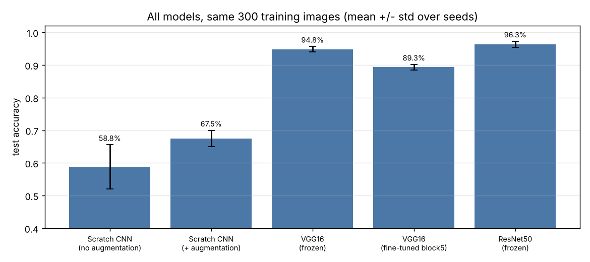
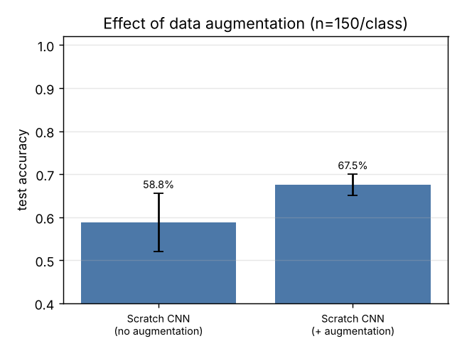
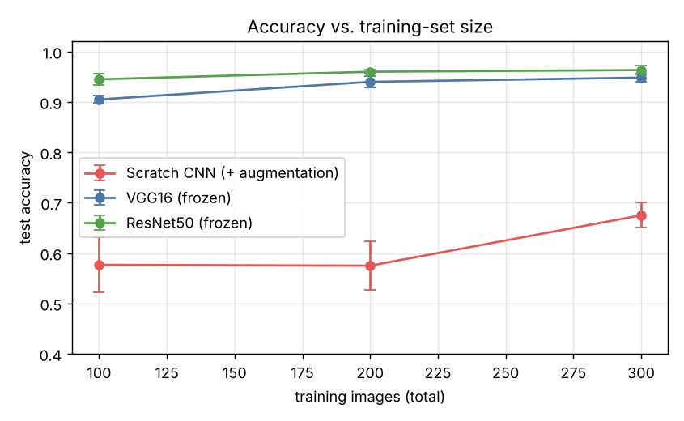
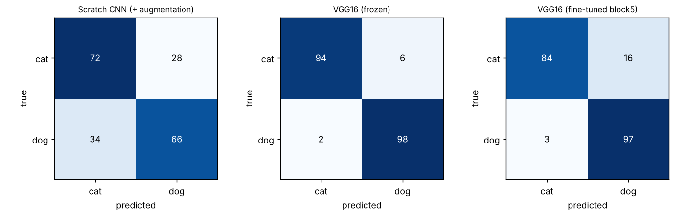

# ECE-5831 HW#9 - Data Augmentation, Transfer Learning and Text Processing

[](https://github.com/Nabonita-Das/ECE5831-HW9/actions/workflows/tests.yml)

This repository contains my solution to HW#9. It has two parts:

| Part | Topic | Deliverable |
|---|---|---|
| 1 | Cat/dog image classification with a **very small training set**: data augmentation, a CNN trained from scratch, and a pretrained VGG16 | `Module_9_1.ipynb` |
| 2 | Text processing: encoding text into numbers and decoding it back | `Module_9_2.ipynb` |

The two notebooks are the graded deliverables (all cells executed, outputs and markdown included).
The same code is also available as a small, tested Python package in `src/hw9`, with command-line scripts.
Two **optional bonus notebooks** go further (multi-seed statistics, augmentation ablation, fine-tuning, a second backbone,
error analysis; and more text representations) - see section 5.

---

## 1. Repository layout

```
.
├── Module_9_1.ipynb            # Part 1 deliverable (executed, with outputs)
├── Module_9_2.ipynb            # Part 2 deliverable (executed, with outputs)
├── Bonus_Part1_Analysis.ipynb  # optional: deeper analysis of Part 1 (executed)
├── Bonus_Part2_Text_Extras.ipynb  # optional: more text representations (executed)
├── run_part1.py                # Part 1 as a script: augmentation -> scratch CNN -> VGG16 -> comparison
├── run_part2.py                # Part 2 as a script: text -> numbers -> text demo
├── run_bonus.py                # bonus experiments (seeds, sizes, fine-tuning, ResNet50, error analysis)
├── src/hw9/
│   ├── config.py               # all constants (image size, split sizes, URLs, seed)
│   ├── data.py                 # builds the limited train/validation/test dataset
│   ├── augmentation.py         # class DataAug
│   ├── models.py               # classes CatsDogsLimit and CatsDogsPre
│   ├── text_process.py         # class TextProcess
│   ├── experiments.py          # bonus experiments, metrics and plots
│   └── text_extras.py          # TF-IDF, hashing trick, BPE, embedding classifier
├── tests/                      # pytest unit tests (27 tests)
├── bonus_results/              # cached results of the bonus experiments (json + test predictions)
├── docs/images/                # figures used in this README
├── .github/workflows/tests.yml # continuous integration (pytest on every push)
├── requirements.txt, pyproject.toml, .gitignore, LICENSE
```

## 2. Quick start

```bash
python -m venv .venv
source .venv/bin/activate            # Windows: .venv\Scripts\activate
pip install -r requirements.txt

pytest                               # unit tests (a few seconds)
python run_part2.py                  # Part 2 demo
python run_part1.py                  # Part 1 (a few minutes on CPU, downloads data on first run)
python run_bonus.py                  # bonus experiments (about 40 minutes on CPU, results are cached)
jupyter notebook                     # or open the notebooks in VS Code
```

Tested with Python 3.13 and TensorFlow 2.21 (CPU). A GPU is not required.

---

## 3. Part 1 - image classification with limited data

### 3.1 The problem
A convolutional network needs a lot of labelled images. When only a few hundred are available, a model
trained from scratch **over-fits**: it memorises the training photos and does poorly on new ones.
Two standard remedies are compared here:

1. **Data augmentation** - create many slightly different versions of every training image.
2. **Transfer learning** - re-use a network that was already trained on a huge dataset (ImageNet).

### 3.2 The limited dataset (`data.py`)
A balanced dataset is built on disk from a pool of cat and dog photos, shuffled with a fixed seed:

| split | images per class | total | purpose |
|---|---|---|---|
| train (limited) | 150 | **300** | fitting the models |
| validation | 50 | 100 | monitoring training / early stopping |
| test | 100 | 200 | final, untouched evaluation |

Both models are trained on **exactly the same 300 images**, which makes the comparison fair.

Data sources, tried in this order:
1. the official `cats_and_dogs_filtered` dataset (Keras download);
2. a backup copy of cat/dog photos (`CAT1.zip`, `DOG1.zip`) downloaded from a public GitHub repository,
   used automatically when the official download is blocked (HTTP 403).

Downloaded files are stored in `data/` and `limited_data/`, which are git-ignored.

### 3.3 `DataAug` (`augmentation.py`)
A `keras.Sequential` block of random transformations:

| transformation | strength |
|---|---|
| horizontal flip | random |
| rotation | up to about 15 degrees |
| zoom | +/- 20 % |
| translation | +/- 10 % |
| contrast | +/- 10 % |

The block is only active during training (Keras random layers are the identity at inference), so it can
be placed **inside** the model without affecting validation or test accuracy.
`show_dataset_samples()` displays original images next to their augmented versions.

### 3.4 `CatsDogsLimit` - CNN from scratch (`models.py`)
```
Rescaling(1/255) -> DataAug -> [Conv(32) + MaxPool] -> [Conv(64) + MaxPool]
-> [Conv(128) + MaxPool] -> [Conv(128) + MaxPool] -> Flatten -> Dropout(0.5)
-> Dense(256, ReLU) -> Dense(1, sigmoid)
```
Binary cross-entropy loss, RMSprop (lr 1e-3), early stopping on validation loss (patience 10, best weights restored).

### 3.5 `CatsDogsPre` - pretrained VGG16 (`models.py`)
* VGG16 with ImageNet weights and `include_top=False` is used as a **frozen feature extractor**.
* Every image is passed through the frozen base once; the resulting 4x4x512 feature maps are cached.
  This is mathematically equivalent to running a frozen base in every epoch, but much faster on a CPU.
* Only a small new head is trained: `Flatten -> Dense(256, ReLU) -> Dropout(0.5) -> Dense(1, sigmoid)`
  (RMSprop, lr 2e-5, early stopping).
* `build_full_model()` assembles base + head into one end-to-end model that accepts raw images.
* Weights are loaded with `weights="imagenet"`; if that download is blocked they are fetched from GitHub
  and cached as `vgg16_notop.h5`.

### 3.6 Results (notebook run, same 300 training images)

| Model | train acc | validation acc | test acc |
|---|---|---|---|
| From scratch (CNN + augmentation) | 61.7 % | 60.0 % | **62.5 %** |
| Pretrained VGG16 - A: cached features + new head | 100 % | 93.0 % | **96.0 %** |
| Pretrained VGG16 - B: end-to-end with data augmentation | 99.3 % | 96.0 % | **96.5 %** |

Both pretrained variants are over **30 percentage points** better than the scratch CNN on the held-out test set.
Variant B feeds every image through `DataAug` and the frozen VGG16 base each epoch (slower on a CPU); the extra gain over A is small.
Exact numbers vary slightly between machines and library versions (random initialisation); the conclusion does not.

### 3.7 Discussion
* **Scratch.** The network must learn edges, textures, shapes and the "cat vs dog" concept from only 300 images.
  Augmentation and dropout help, but there is simply too little data, so accuracy on new images stays low and
  the validation curve is noisy.
* **Pretrained.** The VGG16 base already encodes general visual features learned from 1.4 million ImageNet images
  (which include many cat and dog breeds). Only a tiny classifier has to be learned, so training is fast and
  generalisation is much better.
* **Take-away.** With little labelled data, transfer learning is the most effective tool; augmentation is the cheap
  way to get more out of a model that has to be trained from scratch. They can be combined (augmentation +
  fine-tuning the last VGG block) for further gains.

### 3.8 Figures from the notebook run

| Augmented images | Scratch CNN training curves |
|---|---|
|  |  |

| Pretrained VGG16 training curves | Scratch vs. pretrained |
|---|---|
|  |  |

---

## 4. Part 2 - text processing (`text_process.py`)

Neural networks need numbers, not strings. `TextProcess` converts text to numbers and back.

| Step | Method | What it does |
|---|---|---|
| tokenise | `tokenize` | words (punctuation is its own token, `don't` stays together) or single characters (`mode="char"`) |
| vocabulary | `fit(texts)` | most frequent token gets the smallest id; `0 = <PAD>`, `1 = <OOV>` are reserved |
| **encode** | `encode(text)` | text -> list of integer ids (unknown words -> `<OOV>`) |
| | `encode_batch(texts, maxlen)` | list of texts -> padded / truncated 2-D integer array |
| | `one_hot_encode(text)` | text -> `(tokens, vocab_size)` one-hot matrix |
| **decode** | `decode(ids)` | ids -> readable text (padding skipped, no space before punctuation) |
| | `decode_batch(array)` | 2-D array -> list of texts |
| | `one_hot_decode(matrix)` | `argmax` per row, then decode |
| persist | `to_json()` / `from_json()` | save and restore the vocabulary |

```python
from hw9 import TextProcess

tp = TextProcess().fit(["The cat sat on the mat.", "The dog chased the cat!"])
ids = tp.encode("The dog chased the cat!")      # [2, 8, 9, 2, 3, 10]
tp.decode(ids)                                  # 'the dog chased the cat!'
```

Properties (all covered by tests):
* word-level round trip is exact up to lower-casing and whitespace normalisation;
* words that were not seen in `fit` become `<OOV>` and cannot be recovered;
* character-level mode is fully lossless;
* the notebook also cross-checks the idea against Keras `TextVectorization`.

---

---

## 5. Bonus experiments (optional)

### 5.1 Part 1 deep dive - `Bonus_Part1_Analysis.ipynb`
A single run per model is noisy (the scratch CNN scored 62-70 % on different machines), so every model was repeated with
**3 seeds** on the same limited data (`python run_bonus.py`, implemented in `src/hw9/experiments.py`).

| Model (300 training images) | train acc | test acc (mean +/- std) | test F1 |
|---|---|---|---|
| Scratch CNN, no augmentation | 63.1 % | 58.8 % +/- 6.7 | 0.669 |
| Scratch CNN + augmentation | 73.3 % | 67.5 % +/- 2.5 | 0.686 |
| VGG16, frozen base | 100 % | 94.8 % +/- 0.8 | 0.948 |
| VGG16, fine-tuned `block5` | 100 % | 89.3 % +/- 0.8 | 0.899 |
| ResNet50, frozen base | 99.9 % | **96.3 % +/- 0.9** | 0.964 |



| Does augmentation help? | Effect of training-set size |
|---|---|
|  |  |

**Findings**
1. **Augmentation helps a scratch model** (+8.7 points, and a much smaller spread between seeds), but cannot close the gap to pretrained models.
2. **Transfer learning is stable and data-efficient:** the pretrained backbones already reach about 90-95 % with only 100 training images, while the scratch CNN stays near 58 % until 300 images.
3. **Fine-tuning hurt (-5.5 points).** Unfreezing `block5` on 300 images over-fits (100 % training accuracy); frozen features were the safer choice.
4. **ResNet50 beat VGG16 (+1.5 points)**, so the benefit is not specific to one backbone.
5. **Error analysis:** the frozen VGG16 makes only 8 test errors (6 cats called dogs, 2 dogs called cats); the scratch CNN makes errors in both directions (28 + 34).
   Its most confident mistakes are mostly dark/black cats and cluttered scenes (a person holding the cat, cage bars, text on the photo).



*Caveats:* 3 seeds per setting; a 200-image test set (one image = 0.5 percentage points); hyper-parameters were chosen once and not tuned per model.

### 5.2 Part 2 extras - `Bonus_Part2_Text_Extras.ipynb` (`src/hw9/text_extras.py`)

| Representation | Reversible? | Fixed size? | Unseen words |
|---|---|---|---|
| `TextProcess` ids (HW#9) | yes (up to lower-casing) | no | `<OOV>` |
| `TextVectorizer`: bag-of-words / TF-IDF (+ n-grams) | no (order is lost) | yes | ignored |
| `hash_encode`: hashing trick | **no** (collisions, no vocabulary) | yes | hashed anyway |
| `BPE`: byte-pair-encoding subwords | yes | no | split into known pieces |
| Embedding layer + small classifier (toy sentiment data) | - | - | needs ids first |

---

## 6. Tests

`pytest` runs 27 tests (also executed by GitHub Actions on every push):
* `tests/test_text_process.py` - vocabulary, encoding, decoding, padding, one-hot, OOV, char mode, JSON.
* `tests/test_text_extras.py` - TF-IDF / count / binary vectors, n-grams, hashing, BPE round trip, toy classifier.
* `tests/test_augmentation.py` - augmentation keeps the image shape, changes the pixels while training and is the identity at inference.

## 7. Design notes and limitations
* Seeds are fixed (`config.SEED = 42`) for reproducibility on the same setup.
* The "limited" dataset is deliberately tiny (300 training images) to show the effect of transfer learning.
* Pretrained variant A is plain feature extraction; variant B adds data augmentation. Fine-tuning is explored in the bonus analysis.
* Test images are never used for training, early stopping or model selection.
